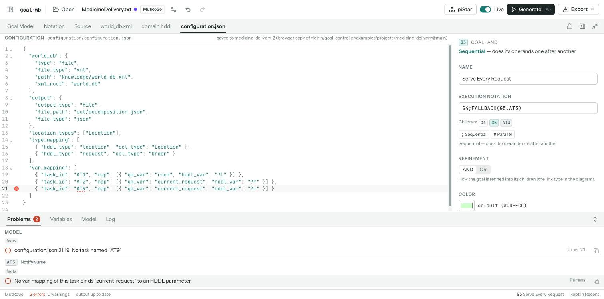

# A relational core for a project's files (spike, #61)

This note records the spike of **architecture 5 of #60**: a relational/query core. A project's files emit facts, and rules derive name resolution, types (#58) and cross-file checks (#59).

The spike's code is `packages/facts` (`@goal-controller/facts`). Its workbench demo runs behind a flag (`?facts=1`). Nothing in the engines changes:

- `pnpm test` passes, and so do the UI's tsc and `pnpm stress:goda`;
- the engines' snapshots are untouched, because no engine file changed.

It was built at the same time as red's #59 (MutRoSe's pool, a TypeScript linker). The two share the **plug-in surface** and the **oracle** (below), so they differ only in how they evaluate.

## Summary and recommendation for #60

- **Adopt the provider interface as the framework capability.**
  - An engine registers providers (one per file kind). Each provider reads its documents into definitions and references with locations, and may add rules.
  - The framework builds one pool per project and serves definition, references, rename, hover and diagnostics in every tab.
  - The interface is the same in both spikes. It is the part that answers #60's question ("a dialect's files share one definition pool without each engine writing its own index").
- **Evaluate the pool with the small Datalog core** (this spike), keeping a TypeScript `checks` escape hatch.
  - **Same results:** the Datalog core and red's linker agree on every oracle case.
  - **Fast enough:** on real projects, a keystroke costs 0.3–1.2 ms.
  - **What Datalog adds:**
    - the rules are **data**, so a dialect could ship them in its definition (Vein 2);
    - providers compose by **union**, without ordering;
    - **one generic rule** reports every unresolved reference. It found two real errors in MutRoSe-Docs that no hand-written check covered.
  - **What it costs:** an evaluator of about 650 lines; stratification constraints that occasionally shape a rule; and a full re-evaluation per change. That re-evaluation is 39 ms at 2,200 elements, so it needs incremental maintenance before models grow tenfold.
- **Follow-ups** (to open as issues once #60 records the decision):
  1. move each provider into its engine (`lib/src/engines/<engine>/pool.ts`);
  2. run the pool in the language worker;
  3. derive `ResourceSymbols` from the pool (completion), then retire them;
  4. replace the goal language's per-document "unknown name" checks with the pool's;
  5. skip unchanged strata (incremental maintenance);
  6. let a dialect definition declare simple providers (JSON/XML paths) and rules.

## The plug-in surface (agreed with #59)

```ts
type PoolProvider = {
  id: string;                       // namespace: 'hddl', 'world', 'gm', 'mutrose', 'edge'
  documents: { resources?: string[]; extensions?: string[]; model?: boolean };
  kinds: Record<string, { label: string; caseInsensitive?: boolean;
                          scope?: 'global' | 'owner' | 'rules' | 'optional' }>;
  refers?: string[];                // qualified kinds it refers to (`world.class`)
  extract(document: PoolDocument): PoolFacts;
  split?(document): PoolDocument[]; // memoize per part (the goal model, per field)
  rules?: string;                   // Datalog (red: `checks?: (pool) => diagnostics`)
  messages?: Record<string, string>;
  renameText?(definition, newName): string | null; // HDDL keeps its `?`
};
type PoolFacts = {
  definitions: { id; kind; name; location; owner?; type?; detail? }[];
  references:  { kinds: string[]; name; location; scope?: { owner } | { via: PoolReference; through: string }; id? }[];
  relations?:  [relation, ...values][];  // Datalog's: namespaced facts (`hddl.super`)
};
definePool(engine, providers, glue?)
```

- **Documents and locations:**
  - A location is `{ document, from, to }`.
  - A resource's document is its path. The goal model's are its fields: `model:<elementKey>:id|name|notation|<property>`.
  - The pool doesn't know the Notation view's layout. The workbench maps a field location onto a range in the Notation view (`ui/lib/workbench/facts.ts`).
- **Namespacing:**
  - A kind is `${provider}.${kind}`, and a provider's own relations are `${provider}.…`.
  - `definePool` rejects:
    - two providers with one id;
    - a kind defined with a dot (outside its namespace);
    - a reference to a kind no provider of the engine defines;
    - a rule deriving a relation outside its namespace.
  - The **open relations** are the exception: `resolves`, `scope`, `through`, `typeOf`, `typeBase` and `problem`. Every provider may add to them, and their rules compose by union.
- **Sharing:**
  - A provider is a value. `hddl` is registered by MutRoSe, and a second engine can register the same value.
  - Options make variants: `hddlProviderWith({ typesByUse: true })` is MutRoSe's HDDL, whose examples use types they don't declare.
  - `test/toy.test.ts` plugs in a toy `.menu` provider with **no change to the core**. It gets diagnostics (its rule and the core's), go-to-definition and references across two files, rename with a conflict check, and incrementality. Two engines then register it.
- **Engine glue:** rules across providers live in one provider or in the engine's glue. MutRoSe's cross-file checks are the configuration provider's rules (`mutrose`), since the configuration is what joins the four files.

## The fact schema

Each document's facts are loaded as these relations. Ids are strings: a definition's comes from its provider (`hddl.task:navigateto`), and a reference's is `<document>#<n>`.

| Relation                                                | Meaning                                                                                                                                                                                                        |
| ------------------------------------------------------- | -------------------------------------------------------------------------------------------------------------------------------------------------------------------------------------------------------------- |
| `defines(S, Kind, Key)`                                 | S defines a name of a kind. Key is the name as compared (lower-cased for a case-insensitive kind).                                                                                                             |
| `refers(R, Kind, Key)`                                  | R refers to a name of a kind, one tuple per kind it may resolve to.                                                                                                                                            |
| `name(Id, Written)`, `in(Id, Document)`                 | As written, and where. Locations stay outside the database.                                                                                                                                                    |
| `owns(Owner, S)`                                        | A member: an HDDL parameter of its task, an attribute of its class, an element of its parent.                                                                                                                  |
| `typeOf(S, Type)`, `typeBase(S, Base)`                  | A definition's type (`Sequence(Request)`) and its base (`Request`). Rules may derive more: a world attribute's type is inferred from its values.                                                               |
| `scoped(R)`, `scope(R, Owner)`, `via(R, R2, Through)`   | Where R is looked up: among an owner's members, or through what R2 resolves to (`type`: the class its target's type names; any other name: a resolver the engine's rules define as `through(Name, X, Owner)`). |
| `kindScope(Kind, global \| owner \| rules \| optional)` | From the providers' kind declarations.                                                                                                                                                                         |
| `<provider>.*`                                          | A provider's own facts: `hddl.super`, `hddl.paramType`, `hddl.decomposes`, `world.attrValue`, `gm.param`, `gm.namesTask`, `gm.use`, `mutrose.binding`, `mutrose.typeMap`, …                                    |

MutRoSe's kinds are #59's:

- **world:** `world.class`, `world.attribute`, `world.instance`, `world.root`;
- **hddl:** `hddl.type`, `hddl.predicate`, `hddl.task`, `hddl.method`, `hddl.action`, `hddl.param`;
- **gm:** `gm.goal`, `gm.task`, `gm.variable`;
- **mutrose:** `mutrose.locationType`.

Edge adds `edge.variable`. GODA's variables are `gm.context`, each defined by its first use.

## The rules

**The core's resolution** (`src/core/rules.ts`, for every pool):

```prolog
resolves(R, S) :- refers(R, K, N), kindScope(K, global), !scoped(R), defines(S, K, N).
resolves(R, S) :- refers(R, K, N), scope(R, O), owns(O, S), defines(S, K, N).
scope(R, O) :- via(R, V, type), resolves(V, X), typeBase(X, T), defines(O, _, T).
scope(R, O) :- via(R, V, Through), resolves(V, X), through(Through, X, O).
resolvable(R) :- refers(R, K, _), kindScope(K, global), !scoped(R).
resolvable(R) :- scope(R, _).
resolvable(R) :- refers(R, K, _), kindScope(K, rules).
problem(R, error, unresolved, '') :- resolvable(R), !resolves(R, _).
problem(R, warning, ambiguous, '') :- resolves(R, S1), resolves(R, S2), S1 < S2.
```

`resolves` and `scope` are mutually recursive: `room.name` needs `room`'s target before `name` can be looked up.

**#59's cross-file checks** (the `mutrose` provider):

```prolog
% a goal-model task stands for the HDDL task its name's first word names
through('mutrose.standsFor', G, H) :- gm.namesTask(G, R), resolves(R, H).
% Params its var_mapping doesn't bind
mutrose.bound(T, N) :- mutrose.binding(TR, GV, _), resolves(TR, T), name(GV, N).
problem(P, error, 'mutrose.unboundParam', '') :- mutrose.configured(_), gm.param(T, P), name(P, N), !mutrose.bound(T, N).
% an hddl_var whose parameter's type doesn't take the variable's class (through type_mapping and HDDL's subtypes)
problem(HV, error, 'mutrose.paramType', '') :- mutrose.binding(_, GV, HV), resolves(GV, G), mutrose.classOf(G, C),
    mutrose.hddlTypeOf(C, H), resolves(HV, P), hddl.paramType(P, PR), resolves(PR, PT), !hddl.subtypeOf(H, PT).
% a select or forAll over a class with no instances
problem(R, warning, 'mutrose.noInstances', '') :- gm.selects(R), resolves(R, C), !world.hasInstance(C).
```

The other checks need no rule of their own:

- a GM task whose HDDL task doesn't exist;
- an `hddl_var` that isn't the HDDL task's parameter (its reference is scoped `via` the `task_id` reference, `through` `mutrose.standsFor`);
- a mapping to an unknown task, variable, type or class.

All of them are the core's `unresolved`. The HDDL provider adds `hddl.subtypeOf` (recursive) and `hddl.unusedTask`, a warning: a task referred to by nothing other than its own methods' `:task`.

**#58's type rules** (the `gm` provider) read each assertion use's shape (`bare`, `eqBool`, `eqNumber`, `ordered`), the type of its literal, and either its declared type (Edge, from `variables.json`) or the types its uses imply (GODA):

```prolog
gm.typeOfUse(U, T) :- gm.declared(U), resolves(U, S), typeOf(S, T).
gm.typeOfUse(U, boolean) :- gm.declared(U), resolves(U, S), gm.element(S), !gm.typedElement(S).
gm.usedAs(N, boolean) :- gm.inferred(U), gm.use(U, bare), gm.useName(U, N).      % also eqBool
gm.usedAs(N, number) :- gm.inferred(U), gm.use(U, ordered), gm.useName(U, N).    % also eqNumber
gm.conflict(N) :- gm.usedAs(N, boolean), gm.usedAs(N, number).
gm.typeOfUse(U, T) :- gm.inferred(U), gm.useName(U, N), gm.usedAs(N, T), !gm.conflict(N).
problem(U, error, 'gm.typeConflict', N) :- gm.inferred(U), gm.useName(U, N), gm.conflict(N).
problem(U, error, 'gm.orderOnBoolean', '') :- gm.use(U, ordered), gm.typeOfUse(U, boolean).
problem(U, error, 'gm.boolOnNumber', T) :- gm.use(U, eqBool), gm.typeOfUse(U, T), gm.numeric(T).
problem(U, error, 'gm.numberOnBoolean', '') :- gm.use(U, eqNumber), gm.typeOfUse(U, boolean).
problem(U, error, 'gm.needsBoolean', T) :- gm.use(U, bare), gm.typeOfUse(U, T), gm.numeric(T).
problem(U, warning, 'gm.intWithDecimal', '') :- gm.literal(U, decimal), gm.typeOfUse(U, int).
```

Details:

- **An unknown name** has no type, so it gets the core's `unresolved` and nothing more.
- **`int` vs. `number`:** `JSON.parse` can't tell `3` from `3.0`. The provider's JSON reader keeps each number's raw text, so `3` is an `int` and `3.0` or `0.9` is a `number`.
- **A correction to #58:** "element references are boolean" is wrong for Edge's typed resources. In tas3-edgev2, `R1` is `{"type": "int"}` and `T3`'s assertion is `R1>50`. Elements now take their declared `type`, and only untyped elements are booleans.

## Q1. The engine: our own Datalog, inputs memoized

- **Rules:** our own small Datalog (`src/datalog`, about 650 lines).
  - Rules are text: `head :- body.`, with `!` negation, comparisons and dotted names.
  - Evaluation is semi-naive. Strata come from the negations (Tarjan); a negation inside a recursion and an unsafe rule are rejected when the rules are compiled.
  - Relations are tuple sets with hash indexes built on demand for the columns a join binds.
- **Inputs:** Salsa-style memoization.
  - Each document (after a provider's `split`) is extracted once per text or value.
  - When a document's facts are unchanged except for their locations (an edit in a comment, a description or whitespace), the derived relations are kept and only the locations move. That's early cut-off at the inputs.
  - Otherwise the rules run again on every document's facts.
- **Why not an existing engine:**
  - `datascript` (470 kB, ClojureScript, entity–attribute triples) has no stratified negation in rules.
  - `datalog-ts` is an application bundling React and Monaco.
  - Neither fits a worker bundle or typed facts.
  - The evaluator's surface is small, and its tests cover recursion, stratification, comparisons, repeated variables and safety.
- **Why not Salsa all the way down** (memoized queries with revisions): almost every rule here is a join with negation over all documents (unresolved, unused, unbound). A per-query memo would be re-run on most edits anyway. Salsa's win is per-function cut-off on deep pipelines, and in this design that's where the inputs are. The recursive rules (`resolves`/`scope`, `hddl.subtypeOf`) would also need fixpoint queries, which Salsa doesn't do.
- **The measured cost of this choice:** a full re-run per change. It's fine up to about 800 elements; the next step is to skip strata whose inputs didn't change, then DRed.

## Q2. Incrementality, measured

Run `pnpm --filter @goal-controller/facts bench` (Node 22, M-series Mac, median of 30). A keystroke is one document changed with its facts changed. "Cut off" means the edit moves locations only.

| Project                                               | Documents | Tuples (facts + derived) | Rules compiled | Cold start (extract + run) | Keystroke, facts change           | Keystroke, cut off | Go to definition | Retained heap |
| ----------------------------------------------------- | --------- | ------------------------ | -------------- | -------------------------- | --------------------------------- | ------------------ | ---------------- | ------------- |
| medicine-delivery (model, world, HDDL, configuration) | 35        | 1105                     | 1.9 ms         | 7.5 ms                     | 1.20 ms (inputs 0.17, rules 1.03) | 0.10 ms            | < 0.01 ms        | 1.0 MB        |
| tas3-edgev2 (model, variables.json)                   | 113       | 656                      | 0.4 ms         | 4.3 ms                     | 0.48 ms (inputs 0.11, rules 0.37) | 0.10 ms            | < 0.01 ms        | 0.5 MB        |
| GODA BSN                                              | 63        | 318                      | 0.4 ms         | 1.4 ms                     | 0.27 ms (inputs 0.07, rules 0.19) | 0.06 ms            | < 0.01 ms        | 0.3 MB        |
| GODA Fragmented                                       | 136       | 913                      | 0.3 ms         | 2.1 ms                     | 0.63 ms (inputs 0.11, rules 0.51) | 0.11 ms            | < 0.01 ms        | 0.4 MB        |
| synthetic GODA, 200 goals × 10 tasks                  | 6602      | 62983                    | 0.3 ms         | 99 ms                      | 44.4 ms (inputs 5.3, rules 39.0)  | 4.4 ms             | < 0.01 ms        | 25.6 MB       |

- **What is recomputed:** one changed document is extracted again (one model field, or one resource file); the others come from the memo. The rules then run again in full. The memo works: the medicine-delivery test checks that editing AT1's Params extracts one document.
- **Bundle:** `packages/facts` adds **35.7 kB minified, 12.8 kB gzipped** to the page or worker. That excludes what the UI already ships: the goal language with Langium, lib's XML reader, dialect and goal-tree.
- **Cold start:** compiling every rule takes 0.3–1.9 ms. The first full evaluation of a real project takes 1.4–7.5 ms.
- **Fragmented's scale:** Fragmented's size is in its 4,092 contexts, which the pool never sees. For scale, the synthetic model is about 15 times BSN's elements.

## Q3. Fact extraction without full grammars

| Format             | Reader                                                                                                                                                        | Provider (lines)                    | What it needed                                                                                                                                                                                                                                                               |
| ------------------ | ------------------------------------------------------------------------------------------------------------------------------------------------------------- | ----------------------------------- | ---------------------------------------------------------------------------------------------------------------------------------------------------------------------------------------------------------------------------------------------------------------------------- |
| Goal model         | goal-tree's `GoalView`, field by field, and the goal language's Langium parser: the assertion's AST, the OCL value's CST tokens, the notation's `RtRef` nodes | `model.ts` (567, of which 23 rules) | Offsets inside each field. OCL patterns (`name : Type`, `select(v:T \| …)`, `->forAll(`, paths) over tokens: #62 (MutRoSe's OCL grammar) replaces them with its AST. GODA's whitespace-ignoring notation reads through `withoutBracketSpaces`, with its offsets mapped back. |
| World XML          | lib's `readXml` (it has offsets)                                                                                                                              | `world.ts` (168, 13 rules)          | Tag-name and text ranges. Closing tags are references, so a rename renames them. Nested entities (`<objects><Object>`) are sequences.                                                                                                                                        |
| HDDL               | an s-expression reader keeping case and offsets (46 lines; lib's lower-cases and is private, and the migration shares one)                                    | `hddl.ts` (283, 4 rules)            | Typed lists, methods' `:task` and subtasks (labelled or `and`), and formulas skipping connectives and numeric effects. Types used but not declared are an option (MutRoSe's examples).                                                                                       |
| Configuration JSON | a JSON reader with ranges (115 lines; `JSON.parse` keeps none)                                                                                                | `mutrose.ts` (142, 8 rules)         | Member and string ranges. Refs are given by path (`var_mapping[].map[].hddl_var`).                                                                                                                                                                                           |
| `variables.json`   | the same JSON reader                                                                                                                                          | `variables.ts` (39)                 | A number's raw text, for `int`.                                                                                                                                                                                                                                              |

None of the formats needed a full grammar, only a reader that keeps offsets.

## Q4. #58 as rules

`test/types.test.ts` covers each rule:

- **Edge**, from `variables.json`:
  - an ordering comparator on a boolean;
  - `=`/`!=` against the wrong type, both ways;
  - a bare variable or `!x` on a number;
  - an int compared with a decimal (a warning);
  - an unknown name gets no type error;
  - an `int` resource;
  - go-to-definition into `variables.json`.
- **GODA**, declared by use:
  - a conflict reported on every use;
  - agreeing uses type the variable;
  - the first use is the definition, so go-to-definition reaches it and rename renames every use.
- **Examples:** tas3-edgev2 and all seven GODA projects have zero diagnostics.

## Q5. #59's checks as rules, and the oracle shared with red

`test/oracle/<case>/` holds a broken copy of medicine-delivery per check, with `expected.json` (file, element, field, underlined text, severity). Red's design checks against the same cases.

| Case                     | Diagnostics (both designs)                                     |
| ------------------------ | -------------------------------------------------------------- |
| clean                    | none                                                           |
| unknown-hddl-task        | `Fly` (AT1's name); `navigateto` is now unused (warning)       |
| unbound-param            | `current_request` in AT2's Params                              |
| hddl-var-not-param       | `?x` in the configuration                                      |
| unknown-mapping-task     | `AT9`; AT3's Params are now unbound                            |
| unknown-mapping-variable | `rooom`; AT1's Params are now unbound                          |
| unknown-mapping-class    | `Order`                                                        |
| unknown-mapping-type     | `place`                                                        |
| unused-hddl-task         | `cleanup` (warning)                                            |
| no-instances             | `Request` in G2's select, `requests` in G3's forAll (warnings) |

**The two designs agree on every case**, including the knock-on diagnostics.

Red also swept MutRoSe-Docs: 10 projects and 13 goal models, each with its world, domain and configuration. `bench/mutrose-docs.ts` runs this pool over them.

- **Provider gaps found:** both designs needed the same four provider-level fixes:
  - HDDL types declared by use;
  - nested world entities;
  - `name : Type` in Monitors;
  - the project's other goal models counting as uses.
- **Result:** this pool then reports **2 diagnostics, and both are true**:
  - `objects_picked` is no attribute of its class (Object Picking). Red's design has no check for unknown attributes, so it doesn't report this one; here it is the generic `unresolved` rule.
  - `G17` in G3's notation isn't one of G3's children (Vital Signs Monitoring). The goal language's existing check reports it too.

## Q6. Services from the same facts, in the workbench

Definition, references, rename and hover are queries over `resolves` plus the locations (`FactPool.definitionAt`, `referencesAt`, `renameAt`, `hoverAt`).

- **Rename** returns each document's edits: a resource's text, and the model's fields. The workbench writes the model's edits to the piStar text through `setNodeText` and `setNodeProperty`, the inspector's own path. So the model, not the view, is what changes.
- **Rename conflicts** are a rule (`rename.conflict`): the new name already defined for the same kind in the same scope. `test/services.test.ts` covers rename of a world class across the three other files, an HDDL parameter (its task's, not a method's), a model task (its id, its parent's notation, the configuration) and the conflicts.
- **Scoped ids:** BSN's two `T1.2` (under G3 and under G4) are kept apart, keyed by the view (`G3/T1.2`). A notation resolves among its own element's children.

**In the workbench (`?facts=1`)**, the Notation view and every resource tab get:

- F12 or Mod-click: go to the definition, in any tab;
- Shift-F12: a references panel;
- F2: an inline rename panel. In the Notation view it takes precedence over the goal language's own F2 where the pool has a name.
- hover with kind and type;
- the pool's diagnostics, underlined.

The pool's problems go to Problems under the source `facts`.



The demo was checked in a browser, on medicine-delivery, through these steps:

1. hover on a configuration's `hddl_var`;
2. Cmd-click to its HDDL parameter;
3. Shift-F12 on the HDDL task, then jump to the goal model's AT1;
4. F2 on `Request` in the Notation view, which renames it to `Order` in the world, the configuration and the model;
5. a broken `task_id`.

**Duplicate diagnostics (#61 R6).** With the flag on, the pool drops its `unresolved` problems on model fields for the kinds the goal language already checks: `world.class` (MutRoSe's unknown type), `gm.child` (not a child) and `edge.variable`. Nothing in the existing services changes.

**Found on the way (#64, fixed in #66):** the workbench saved resource edits with one debounce timer shared by every file. Edits to two files within 500 ms kept only the last file's save, so a rename's world edit was lost on reload. A cross-file rename shows correctly in every tab without #66, but persists only with it.

## Q7. Declarativeness: what a dialect could declare

The spike's split between data and code:

| Could be declared in a dialect definition                                                                                                      | Stays code                                                                                                   |
| ---------------------------------------------------------------------------------------------------------------------------------------------- | ------------------------------------------------------------------------------------------------------------ |
| kinds: label, case, scope                                                                                                                      | readers that keep offsets: XML, s-expressions, JSON with ranges, the goal language (shared, framework-owned) |
| references from structured formats, by path: `var_mapping[].task_id → gm.task`, `type_mapping[].ocl_type → world.class`, `<tag> → world.class` | extraction of free text inside a value: OCL patterns (until #62), HDDL's typed lists, a notation's bracket   |
| scopes by owner or through another reference (`via … through 'type'`)                                                                          | the model's split per field and its mapping to the Notation view (framework)                                 |
| every rule (all of this spike's checks: 48 lines of Datalog across four providers) and messages                                                | inference that needs a whole-file pass: GODA's first use, types used but not declared                        |

So a JSON- or XML-shaped resource could plug in as a definition (kinds plus paths plus rules). A format with its own syntax brings a reader once, and the framework shares it.

## What worked, and what didn't

**Worked**

- One interface for every format.
  - A toy provider plugs in unchanged.
  - The four MutRoSe providers and Edge's were written against it without touching the core.
- Resolution as rules: one generic `unresolved` rule replaces one check per reference kind, and it found real errors.
- Recursion where it was needed: a path through a variable's type, and HDDL subtyping in `mutrose.paramType`.
- Early cut-off at the inputs: 0.06–0.11 ms on real projects when only locations move.
- Typed facts carry #58's rules with no special machinery, for both Edge and GODA.

**Didn't, or cost more than expected**

- **Stratification shaped the rules.**
  - The world's type inference had to resolve instance values outside `resolves`. Otherwise `typeOf` would depend negatively on the recursive core.
  - A user-written rule can hit the same error ("not stratifiable"). The message names the cycle, but it's a new kind of error for dialect authors.
- **Full re-evaluation is linear in the project.** It's 39 ms at 2,200 elements. Real models are far below that today, but #60's criterion is "as you type", so skipping strata is the first follow-up.
- **The browser couldn't deliver function keys to a read-only editor.** A read-only CodeMirror view doesn't take focus. The demo uses a browser copy; Mod-click and hover work read-only.
- **Rules are harder to debug than functions.** The spike has no explain or trace facility yet (which rule derived a problem). It's a small addition to the evaluator, and dialect authors would need it.

## Migration from `ResourceSymbols`

1. **Done in this spike:** the pool runs beside everything, behind the flag. Its diagnostics are their own Problems group, and duplicates are dropped.
2. Move each provider into its engine (`lib/src/engines/<engine>/pool.ts`), registered with the definition's `projectResources`. The parsers keep their `data` for checks and templates.
3. Derive each kind's `ResourceSymbols` from the pool (`defines` by kind, `owns` for members, `typeOf` for details), and check that completion gives the same items in every example.
4. Replace the goal language's per-document checks of names (`unknownNames`, unknown world classes, not-a-child) with the pool's, and remove the R6 filter.
5. Run the pool in the language worker. Its input is texts and the view's fields, already JSON.
6. Retire `ResourceSymbols` once nothing reads them.
